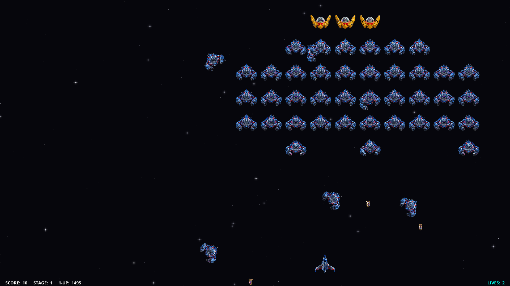

# Aliens Invaders

  

---

## Verified Builds

Every push is compiled and tested (49 headless unit tests) on five legs:

| Leg | Toolchain | Notes |
|---|---|---|
| Linux (gcc) | GCC, libstdc++ | native `std::jthread` path |
| Linux (clang) | Clang, libstdc++ | native `std::jthread` path |
| macOS 15 | Apple Clang, libc++ | `Portable::` threading fallback (no P0660) |
| Windows | MSVC (VS2022) | SDL3 via vcpkg; `.exe` artifact per run |
| FreeBSD 14 | base Clang, libc++ | inside a `vmactions` VM |

Tagged pushes (`v*`) publish self-contained bundles — SDL3 and the MIT-licensed
FluidR3 GM SoundFont (Git LFS) included — on the [Releases](../../releases) page.
The Steam launch roadmap (depots, store page, legal) lives in [STEAM.md](STEAM.md).

---

## Mission Briefing: Attention, Fellow Earthlings! 🌍🛸

While humanity was busy arguing on social media, perfecting artisanal coffee foam, and debating whether pineapple belongs on pizza, deep-space sensors detected a massive extraterrestrial armada descending upon our solar system.

Their diplomatic delegation arrived in synchronized wedge formation deploying high-yield plasma mortars. In universal galactic etiquette, that translates roughly to: *"Hand over the planet; your lease expired three minutes ago."*

You have just been promoted to Lead Planetary Interceptor Pilot (mostly because everyone else called in sick today). Your mission is simple:
1. **Climb into the cockpit** of an experimental Earth defense spaceship.
2. **Blast through synchronized dive-bombing formations.**
3. **Grab tactical nuke warheads** and supercharged multi-cannons.
4. **Remind these extraterrestrial tourists** why they should have taken that left turn at Alpha Centauri.

---

## Ship Hangar & Experimental Arsenal

Select your combat spaceship in the menu by pressing <kbd>T</kbd>:
- **The Cruiser (Standard Model):** The battle-hardened workhorse of Earth's defense fleet. Balanced aerodynamics, reinforced titanium hull, and dual high-frequency plasma dissipation rails.
- **The Vanguard (Apex Prototype):** Next-generation experimental interceptor featuring dual swept-wing ion thrusters, tighter lateral drift, and high-visibility cockpit canopy.

### Battlefield Power-Ups:
*In each 15-wave stage, a maximum of 5 supply pods can appear across all waves, with each bonus type dropping at most once per stage (zero duplicate bonus drops within the same stage).*

- 🔵 **Speed Boost:** Overclocks sub-light maneuvering thrusters (+30% agility, max 250%).
- 🔴 **Rapid Fire:** Maximizes plasma cannon cyclic rate (+10% fire rate, max 120%).
- 🟣 **Multi-Cannon:** Quad-plasma spread firing solution (up to 3 simultaneous shots).
- 🟢 **Shield Protection:** Restores reinforced electromagnetic shielding (+1 hull shield point, max 8).
- 🟡 **Tactical Nuke:** Screen-clearing atomic blast vaporizing all active hostiles in a flash of nuclear glory (max 1 per 15-wave stage).

### Notable Hostiles & Fleet Kinematics:

- 🧠 **Alien 14 — Chief Theorist "Albert Alienstein" (Relativistic Warp Evasion):** 60% of Alien 14 starships are born relativistic, each carrying exactly **2 spacetime jumps**. Any player bullet breaching the proximity radius (2.4× the hull half-diagonal) is dodged *before impact*: the ship consumes one jump, folds into warp with its physical colliders deactivated (your bullet keeps flying straight through the vacated space, leaving a ghost-afterimage trail) and re-materializes in a free honeycomb cell at least **5 Chebyshev cells** away from both its previous station and your starship — a deterministic O(1) draw over the active formation minus both exclusion zones, with a 1.4 s cosmetic recharge halo. While any evasion remains, projectiles can never kill one; after the second jump it dies like any hostile. Only the **Tactical Nuke** vaporizes an Alien 14 mid-warp.
- ☢️ **Alien 4 — "Madame Curie" (Alpha Decay):** 20% spawn with a quantum electrosphere needing 2 impacts — the first hit shrinks the hull to 50%, triples the electron orbit and accelerates the ship by +30%.
- 🚀 **Continuous 60 Hz kinematics everywhere:** the armada drifts as a formation between cruise bounds, attack dives follow inertial Catmull-Rom splines, every station return is a banked rate-limited arc (no sideways or backwards sliding), and hull attitudes turn through partitioned angular slices — no teleports, no stair-steps, no micro-jumps, on any refresh rate.

---

## Flight Controls

| Key | Gamepad (Xbox / Standard) | Tactical Action |
| :--- | :--- | :--- |
| <kbd>Space</kbd> | <kbd>A</kbd> / <kbd>RT</kbd> | Fire Primary Plasma Cannons |
| <kbd>←</kbd> / <kbd>→</kbd> | Left Analog / D-Pad | Fly The Spaceship Horizontally |
| <kbd>T</kbd> | <kbd>Y</kbd> | Toggle Ship Model (*Cruiser* vs *Vanguard*) |
| <kbd>LT</kbd> / <kbd>RT</kbd> | <kbd>LT</kbd> / <kbd>RT</kbd> | Cycle Menu Pages (Left / Right) |
| <kbd>-</kbd> / <kbd>+</kbd> | <kbd>LB</kbd> / <kbd>RB</kbd> | Adjust Particle Density (Levels 0 to 4) |
| <kbd>F</kbd> | — | Toggle Fullscreen Mode (Native monitor resolution up to 4K UHD) |
| <kbd>1</kbd>, <kbd>2</kbd>, <kbd>3</kbd> | — | Preset Resolution Scales (`1280x720`, `1600x900`, `1920x1080`) |
| <kbd>I</kbd> / <kbd>B</kbd> | <kbd>B</kbd> | Toggle Telemetry Overlay (CPU%, RAM%, FPS, SDL Driver) |
| <kbd>H</kbd> | <kbd>Back</kbd> | Hall of Fame Leaderboards & Tactical Dossiers |
| <kbd>P</kbd> | <kbd>Start</kbd> | Pause / Resume Active Combat |
| <kbd>S</kbd> | <kbd>Start</kbd> | Launch Match (Start game from menu) |
| <kbd>C</kbd> | — | Cheat Mode (Instant max firepower; disables leaderboard saving) |
| <kbd>Q</kbd> | — | Quit Combat or Return to Desktop |

---

## Local Arcade Hall of Fame (Multi-User)

*Aliens Invaders* honors the classic arcade spirit. On Linux/FreeDesktop systems, scores are saved to standard sandboxed storage (`~/.local/share/aliens-invaders/` on Linux, `%APPDATA%\aliens-invaders\` on Windows, and sandboxed containers on macOS, Android, and iOS).

Every row in the `.scores` ledger ends with a `HASH` column: a truncated, salted SHA-256 digest that the game computes over the row's exact contents. The file stays human-readable, but a hand-edited or forged row fails verification and is silently dropped the next time the Hall of Fame loads -- the leaderboard only trusts runs the game itself signed.

---

## Technical Highlights

- 🖥️ **Vulkan-first rendering with automatic fallbacks** — OpenGL, OpenGL ES 2, Metal, Direct3D 12/11 and software, in that order; choose one with `-driver` and list what your display offers with `-backends`.
- ⏱️ **Rigid 60 Hz deterministic simulation** decoupled from the monitor: a bounded physics accumulator (at most 2 catch-up steps per frame; external stalls are charged as a single step) plus subpixel render interpolation — identical gameplay on 60, 120, 144, 240 and 360+ Hz displays.
- 🔤 **GPU font atlas over a dense ASCII glyph set (32-126)** — quantized design sizes baked once at startup, budgeted prewarm slices after resolution changes, and a baked-string cache that collapses steady HUD frames into single blits.
- 🧵 **Modern C++20 concurrency** — every background worker is a `std::jthread` with cooperative `std::stop_token` cancellation; the SDL audio callback mixes from a wait-free SPSC command ring and never touches a mutex, and high scores persist off the render thread through a temp-file + atomic rename.
- 🚫 **Zero steady-state allocation in the 60 Hz loop** — fixed-capacity pools, swap-and-pop active lists and a LIFO recycle bin re-arm fallen aliens on the same warm heap blocks.
- 🎼 **Dual-engine 2.1 symphonic audio** — the same written scores render through a SoundFont bank (TinySoundFont, default) or the zero-asset procedural synth, both through one shared finishing chain (hall reverb, ear-guard shelf, edge fades, 0.92 peak normalization).
- 📊 **Frame-hitch flight recorder** — `-log` prints one aligned row per slow frame with the culprit phase, an automatic verdict (EXTERNAL / ENGINE / CPU-STARVED / INPUT / PACING) and a ranked session offender summary.

---

## How to Enlist & Compile

Built with modern **C++20** and native **SDL3**, the engine compiles effortlessly across all major operating systems using either **CMake** or **Make**:

### Command-Line Driver & Audio Options

Every flag is **dash-agnostic**: one or more leading dashes are accepted and equivalent, so `-version`, `--version` and `---version` all select the same option. The table below exposes exactly two spellings per option — the canonical long name and, when one exists, its short letter — with no alias clutter.

| Options | Action |
| :--- | :--- |
| *(no arguments)* | Launch game (prioritizes Vulkan with automatic OpenGL fallback) |
| `-driver`, `-d` `<name>` | Launch with specific graphics driver (`vulkan`, `opengl`, `opengles2`, `software`) |
| `-backends`, `-b` | List all available 2D graphics rendering backends (SDL3 drivers) supported on current display |
| `-list`, `-l` | Print 15-track classical symphonic soundtrack anthology and exit |
| `-play`, `-p` `<tracks>` | Play soundtrack movements in headless terminal mode: a single track (`3`), an inclusive range (`1 15`), or a comma-separated list in any order (`6,1,15,2,8`; spaces around commas optional, repeats allowed); each track complete by default |
| `-shuffle` | Jukebox only: play the `-play` selection (range or list) in random order (fresh permutation per run; long form only - `-s` belongs to `-start`) |
| `-start`, `-s` `<sec>` | Jukebox only: open the playback window at `<sec>` seconds (default `0`; combine with `-play`) |
| `-end`, `-e` `<sec>` | Jukebox only: close the playback window at `<sec>` seconds (default: each track's full scored length, printed by `-list`; any value clamps to it; combine with `-play`) |
| `-output`, `-o` `<file>` | Jukebox only: write the window to a file instead of playing it (`.wav` natively; compressed formats via encoders found on PATH) |
| `-render`, `-r` | Force the procedural synth renderer for game and jukebox (default engine: the TinySoundFont bank whenever a `.sf2` is installed) |
| `-log` | Arm the frame-hitch flight recorder (same as `ALIENS_HITCH_LOG=1`; threshold via `ALIENS_HITCH_MS`) |
| `-version`, `-v` | Print the version banner (release, engine, license, repository) and exit |
| `-help`, `-h` | Display command-line manual and option reference |

#### Soundtrack Jukebox (`-list`, `-play`, `-start`, `-end`, `-shuffle`)

Each movement is scored as **one continuous performance at its own length** - no internal seams: the anthology is scored as complete works - one translation unit per movement - and `-list` prints every track's exact scored length. The fanfare heard in-game is the movement's climatic six seconds (`peak_start_seconds` in its manifest, frozen by ear per track), tapered by the shared fade-out, and each performance resolves in a dolce cadence under the same fade-out.

    aliens-invaders -list                        # list all 15 movements
    aliens-invaders -play 3                      # track 3, complete (the default window)
    aliens-invaders -play 3 -s 6 -e 30           # track 3, a slice from second 6 to 30
    aliens-invaders -play 1 15                   # the whole anthology, each track in full
    aliens-invaders -play 6,1,15,2,8             # exactly these tracks, in this order
    aliens-invaders -play 1 15 -shuffle          # the anthology in random order

`-play` accepts a single track (`3`), an inclusive range (`1 15`) or a comma-separated list in any order (`6,1,15,2,8`) - spaces around commas are optional (`6, 1, 15` works too) and a list may repeat tracks; malformed numbers earn a didactic error instead of silence.

`-start` (`-s`) defaults to `0` and `-end` (`-e`) defaults to each track's full scored length (printed by `-list`), so `-play <n>` performs the complete movement; pass explicit values to narrow the window - any slice as short as one second is valid. Playback is headless in the terminal with a live progress bar; `Ctrl+C` stops it cleanly. Pass `-shuffle` to play a multi-track range in random order - a fresh permutation is drawn per run and printed before playback (playback only: `-output` writes a single, fixed track).

#### Audio Output (`-output`, `-o`)

To capture exactly what playback produces (voice gains, soft limiter,
16-bit) for sharing or analysis, `-output` writes the selected window to a
file: WAV natively (zero dependencies) or FLAC/MP3/OGG/Opus/M4A piped
through an encoder found on PATH (`ffmpeg`, `flac`, `lame`, `oggenc`,
`opusenc`; graceful WAV fallback when none is installed). The SoundFont
bank is the default engine when one is installed; `-r` renders through
the procedural synth:

    aliens-invaders -play 5 -s 0 -e 30 -output beethoven_tsf.flac
    aliens-invaders -play 5 -s 0 -e 30 -output beethoven_render.wav -r

#### CD-Quality SoundFont Backend (optional)

Drop any GM-compatible SoundFont (`.sf2`) into `assets/soundfonts/` (or
`~/.local/share/soundfonts/`, `/usr/share/soundfonts/`, or point the
`ALIENS_SOUNDFONT` environment variable at a file) and the 15 movements
render through
[TinySoundFont](https://github.com/schellingb/TinySoundFont) with real
instrument samples by default - recommended bank:
[FluidR3 GM](https://sourceforge.net/projects/fluid-soundfont/) (MIT
license, ~141 MB; distro packages: `soundfont-fluid` on Arch/Manjaro,
`fluid-soundfont-gm` on Debian/Ubuntu/Fedora). Its plain sample-mapping
translates one-to-one through TinySoundFont, whose renderer does not
implement SoundFont modulators - and its warm pianos and lush strings suit
the classical ensemble. With no bank installed the procedural synth takes
over automatically (zero assets, always works); `-r` (`-render`)
forces the procedural engine per run. The binary grows ~100 KB (the
synth is a vendored single header, the bank stays external, and the
Release linker drops unused code with `--gc-sections`).

#### Climatic Preset & Score Toolchain (`tools/midi2cpp`)

The stage fanfare of the standard game flow (debriefing, stage victory,
hyperspace transition) plays each movement's **climatic six seconds**: the
window `[peak_start_seconds, peak_start_seconds + 6]` published by the
track's `ScoreManifest`, frozen by ear as `kPeakStartSeconds` in
`src/musics/music_NN.cc` (`0.0f` keeps the movement's opening; the test
suite enforces that the window fits inside the scored length). Audition
and freeze one track at a time:

    ./aliens-invaders -play 3 -start 41 -end 47    # hear the candidate window
    # edit src/musics/music_03.cc:  constexpr float kPeakStartSeconds = 41.0f;
    make -j15 && make test

Scores themselves are regenerated from MIDI with `tools/midi2cpp`, which
emits the canonical `music_NN.cc` (climatic-preset manifest included):
`--orchestrate` voices reductions across the ten seats after the German
symphonic tradition (stratified string core, rotating woodwind color,
brass only on energetic peaks), an always-on loudness normalization pulls
every work onto a common anthology RMS anchor, pitches above A6 are
octave-folded (ear guard), and `--peak <sec>` freezes the climatic preset
during regeneration:

    tools/midi2cpp mids/08-Maurice_Ravel-Bolero.mid -t 08 -o src/musics/music_08.cc \
        --trim --orchestrate --floor 0.050 --peak 412.5 -v

Both render backends share the same finishing chain - hall reverb, the
ear-guard high-shelf above ~4.2 kHz, the fade envelopes defined uniquely
in `constants.h`, and peak normalization to 0.92 - so every window of
every track lands at one perceived loudness and brightness.

#### Frame-Hitch Flight Recorder (`-log`)

`aliens-invaders -log` (exact equivalent: `ALIENS_HITCH_LOG=1`) arms a flight recorder for frame hitches. Disarmed, it costs nothing: no threads, no output, one predictable branch per call. Armed, every frame lasting at least the report threshold (default 33.3 ms; override with `ALIENS_HITCH_MS=<4..2000>`) produces exactly one row of an aligned terminal table, and a one-shot legend printed at startup documents every column. Rows carry no repetitive per-line prefix — the once-per-session banners and the rare `[hitch-freeze]` / `[hitch-stutter]` event tags identify the stream, keeping every data row 8 columns shorter in narrow terminals. In short:

- **Phase columns** (`in`, `sim`, `ren`, `pre`, `pac`) tile the frame exactly; the dominant phase carries a `*` (bold red on terminals) and is the *culprit*.
- **`cpu` column** — thread CPU time the render thread actually burned during the frame (`CLOCK_THREAD_CPUTIME_ID`; `n/a` where the platform cannot measure it). The evidence behind the engine-vs-machine split: `cpu ≈ total` means the engine owned the frame; `cpu << total` means the thread was off-CPU (preempted, starved, or blocked in a driver/OS call) and prints blue next to a `CPU-STARVED` verdict.
- **Verdict** — an automatic, deterministic classification printed on every row: `EXTERNAL` (the wait is inside the graphics driver/compositor — not game code), `ENGINE-RENDER`, `ENGINE-SIM` (engine code burned the frame on-CPU), `CPU-STARVED` (an engine phase dominates, yet the render thread received < 50% of the frame as its own CPU time — the scheduler, a competing process, or a blocking driver/OS call owned it), `INPUT` (event-pump stall), `PACING` (frame-limiter oversleep). Each tag explains itself once, on a dim `verdict key:` line under its first occurrence.
- **`↳` detail rows** rank the instrumented functions by *aggregate self time* (sum over all calls in the frame), with the **largest single call** (`max`) and the representative caller chain (`via`) — the difference between one blocking call and death by a thousand cuts.
- **`ctx` suffix** names the window-system events the frame carried: `RESIZED`, `FULLSCREEN`, `PRESET`, `SETTLING` — cost and cause on the same row.
- **Freeze warnings** (`[hitch-freeze]`, bold red) fire when a frame stays open ≥ 250 ms: they show the live phase, how long it has been running (`in phase`), the already-closed phase breakdown (`so far`), and the innermost active scope.
- **EXTERNAL bursts** of ≥ 3 near-consecutive slow presents are annotated as one compositor-busy window (wallpaper changes, desktop repaints, overview) — the game was waiting, not working.
- **Stutter-pattern notes** (`[hitch-stutter]`, one per recovered episode) — the cadence watch keeps a 16-frame rolling window of the pacing rhythm; only *presented, sub-threshold* frames enter it (a frame ≥ 33.3 ms is a hitch that already prints its own row, and a sub-2 ms frame never presented anything — bookkeeping, not pacing). When the window's frame totals swing by ≥ 10 ms for ≥ 24 consecutive evaluations, the recovered episode prints one annotation (frame range, length, min/max/spread, dominant phase). That is the visible *stuttering* per-frame hitch rows are blind to by construction.
- The **session summary** counts the stutter episodes, tallies verdicts and splits offenders into two tables: EXTERNAL waits (the machine's own time) and IN-ENGINE code (the actionable ranking).

Colors activate only when stderr is a real terminal; piped or redirected logs stay plain text, grep-friendly, with identical column alignment.

---

### Prerequisites

- **Arch Linux / Manjaro:**
    sudo pacman -S sdl3 cmake ninja pkgconf gcc

- **Debian / Ubuntu / Linux Mint:**
    sudo apt install libsdl3-dev cmake ninja-build pkg-config build-essential

- **Fedora / RHEL:**
    sudo dnf install sdl3-devel cmake ninja-build pkgconfig gcc-c++

- **macOS (Homebrew):**
    brew install sdl3 cmake ninja pkg-config

- **Windows (MSYS2 UCRT64):**
    pacman -S mingw-w64-ucrt-x86_64-gcc mingw-w64-ucrt-x86_64-sdl3 mingw-w64-ucrt-x86_64-cmake ninja make

---

### Option A: Build with CMake (Recommended for Cross-Platform)

    # 1. Configure and compile

    cmake -B build -DCMAKE_BUILD_TYPE=Release -DBUILD_TESTS=ON
    cmake --build build -j$(nproc)

    # 2. Run automated test suite & launch

    ./build/unit_tests              # Run automated headless C++20 test suite
    ./build/aliens-invaders         # Launch game

    # 3. System Installation (Optional)

    sudo cmake --install build

    # 4. Uninstallation

    Cleanly remove all installed files using CMake's generated manifest:
    sudo xargs rm -vf < build/install_manifest.txt
---

### Option B: Build with Makefile
    make -j$(nproc)        # Compile release binary (-O2)
    make test              # Run automated C++20 test suite
    make sanitize          # Compile with AddressSanitizer and UBSan
    sudo make install      # Install binary, icons, desktop entries and man page to system
---

### Option C: Distro Packaging (AUR / Flatpak)

    packaging/PKGBUILD                            # Arch/Manjaro package (CMake + Ninja, runs ctest)
    packaging/org.claudiofsr.aliens_invaders.yml  # Flatpak manifest (Freedesktop runtime 23.08)

The Flatpak sandbox exposes exactly what the game needs and nothing more:
Wayland (with X11 fallback), PulseAudio, DRI — and `--device=input`, the
precise permission that keeps SDL gamepads working inside the sandbox.

---

## Author & Copyright

**Claudio Fernandes de Souza Rodrigues**
Lead Engine Architecture, C++20 Systems, Procedural 2.1 Audio, Aerodynamics & Gameplay.
GitHub: [@claudiofsr](https://github.com/claudiofsr)

Copyright (c) 2026 Claudio Fernandes de Souza Rodrigues. All Rights Reserved.

Licensed under the **MIT License** - see the [LICENSE](LICENSE) file for details.

